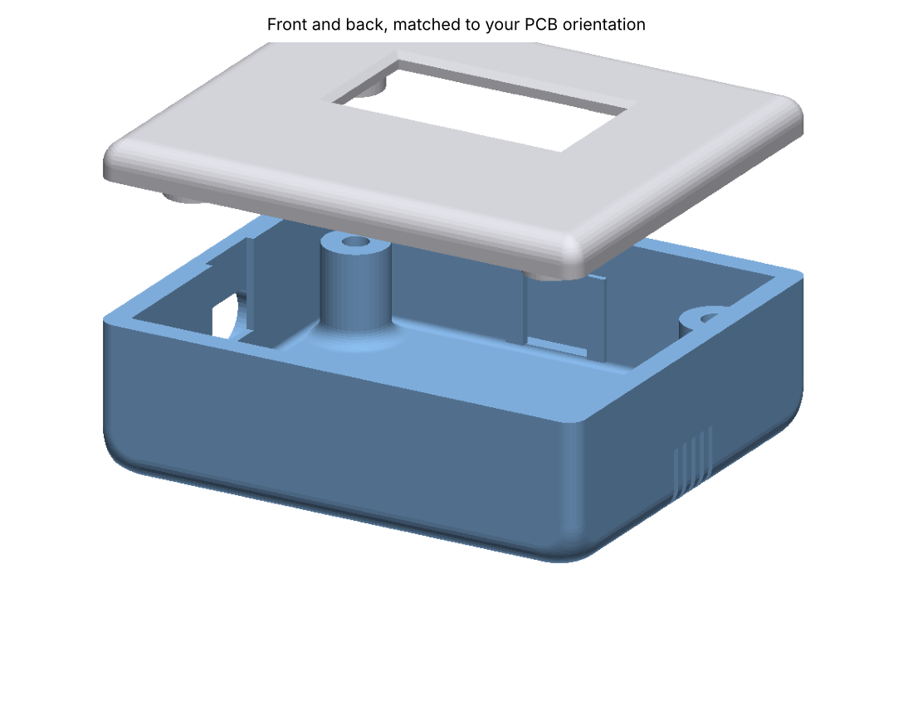
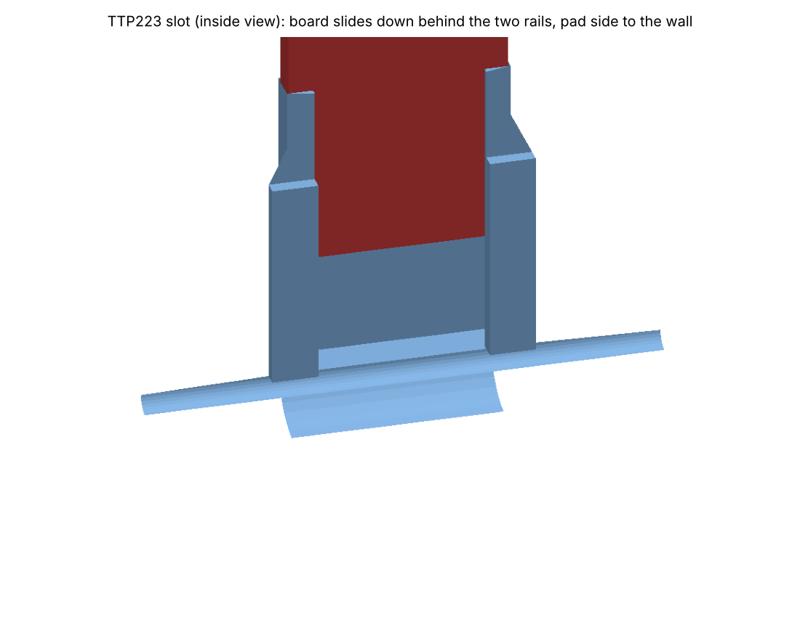

# Momowo 摸摸我 Build Guide

This guide shows you how to build a Momowo from parts, step by step. It's written for complete beginners: if you have never soldered or used a microcontroller before, that's fine. Every step says what to do and why.

When Momowo is built, the **Momowo User Guide** explains how to set it up and use it.

**Time:** an afternoon (about 3 to 4 hours the first time, not counting 3D printing).
**Difficulty:** beginner, with a little soldering.

---

## 1. What you'll build

Momowo is made of a few small ready-made boards (called *modules*) joined with wires, inside a 3D-printed case:

| Part | What it does in Momowo |
|---|---|
| **ESP32-C3 SuperMini** | The brain. A tiny computer with Wi-Fi that runs the Momowo program (the *firmware*). Its USB-C socket also powers Momowo. |
| **1.3" OLED screen** (SH1106, 128×64, I2C, 4 pins) | The face. |
| **TTP223 touch pad** | The touch spot on Momowo's head. It senses your finger through the case. |
| **Passive buzzer** | Makes Momowo's sounds. |
| **MPU6050 motion sensor** (GY-521 board) | Lets Momowo feel pats, shakes, tilts and drops. |
| **DS3231 clock** (optional) | Keeps the time during power cuts when there's no Wi-Fi. You can leave it out. |

You don't need to understand how these work inside. You only connect their pins as shown below.

---

## 2. Shopping list

### Parts

Search for these names in an electronics shop or online marketplace. Buy one of each unless it says otherwise.

| Search for | Notes |
|---|---|
| ESP32-C3 SuperMini | Make sure it is the **C3 SuperMini**, about the size of a thumbnail, with a USB-C socket. |
| 1.3 inch OLED SH1106 I2C 128x64 | Choose the version with **4 pins** (GND, VCC, SCL, SDA). White or blue screen, either is fine. |
| TTP223 touch sensor module | A small square board with a round pad on one side and 3 pins. |
| Passive buzzer module or passive buzzer 3V | It must say **passive**. An *active* buzzer can only beep one note. |
| GY-521 MPU6050 module | The motion sensor. |
| DS3231 RTC module (optional) | Only if you want the time kept without Wi-Fi. |
| Header pins, 2.54 mm | Usually included with the modules. |
| Silicone wire, 28 or 26 AWG, a few colours | For the connections. Silicone wire is soft and easy to bend in a small case. |
| M3 x 12 mm screws, 4 pieces | To close the case. |
| USB-C cable and a USB phone charger | To power Momowo. Use a cable that carries data too (not a "charge only" cable), so you can also load the firmware with it. |

### Tools

| Tool | Why |
|---|---|
| Soldering iron with a stand (around 60 W, with temperature control if possible) | To join wires to the pins. |
| Solder wire, 0.6 to 0.8 mm, with flux inside ("rosin core") | The metal that makes the joint. |
| Wire stripper (or small scissors, carefully) | To remove the plastic from wire ends. |
| Small side cutters | To trim wires and pin ends. |
| Tweezers | To hold small parts. |
| A computer with the Chrome or Edge web browser | To load the firmware onto Momowo. |
| Optional: a breadboard and jumper wires | To test everything before soldering. |
| Optional: a multimeter | To check connections. |

### The case

The case has two printed parts: the **back** (a box) and the **front** (the face plate with the screen window). The files are in the `enclosure` folder: `Momowo_Backside.stl` and `Momowo_Front.stl`.

- **If you have a 3D printer:** PLA works well. Print each part flat on its largest side, with 0.2 mm layers and 15 to 20% infill.
- **If you don't:** upload the two `.stl` files to an online 3D printing service, or ask a local makerspace or library.

---

## 3. Safety first

- A soldering iron is hot enough to burn you (around 300 °C). Always put it back in its stand, and never touch the metal part.
- Solder in a room with fresh air, and wash your hands afterwards.
- Unplug Momowo before changing any wire.
- Use only **3.3 V** (the pin marked **3V3**) for the modules, as shown below. Never connect the modules to 5V.

---

## 4. Soldering in 2 minutes

You only need two kinds of joint: a pin into a board, and a wire onto a pin.

1. Heat the iron (about 330 °C for leaded solder, 360 °C for lead-free).
2. Touch the iron's tip to **both** the pin and the metal ring around it, for 2 seconds.
3. Feed a little solder into the joint (not onto the iron). It flows around the pin.
4. Take the solder away, then the iron. Don't move the parts for a few seconds.
5. A good joint is shiny and shaped like a small volcano. A dull ball means it needs to be heated again.

**To join a wire to a pin:** strip 3 mm of plastic from the wire, twist the strands, coat the tip with a little solder ("tinning"), then hold it against the pin and heat both until the solder melts together.

**Tip:** if two neighbouring pins get joined by a blob of solder by mistake, heat the blob and drag it away with the iron's tip.

---

## 5. Load the firmware (before building)

Load the Momowo program onto the SuperMini first. That way you know the board works before you solder anything to it.

### Option A: in your web browser (easiest)

1. Open Chrome or Edge on your computer and go to the **ESP Web Flasher**: [espressif.github.io/esptool-js](https://espressif.github.io/esptool-js/).
2. Plug the SuperMini into the computer with the USB-C cable.
3. Click **Connect** and choose the port that appears (it may be called *USB JTAG/serial debug unit* or similar).
   - If nothing appears, unplug the board. Then hold the tiny **BOOT** button on the SuperMini, plug it back in, and release the button. Click **Connect** again.
4. Under *Flash Address* enter `0x0`. Choose the file `Momowo-esp32c3-merged.bin`.
5. Click **Program** and wait until it says it has finished (about a minute).
6. Unplug the board and plug it in again. The program now starts on its own.

### Option B: with the Arduino IDE (if you want to change the code)

1. Install the **Arduino IDE** (version 2) from [arduino.cc](https://www.arduino.cc/en/software).
2. In *Settings → Additional boards manager URLs*, add `https://espressif.github.io/arduino-esp32/package_esp32_index.json`. Then in the *Boards Manager*, install **esp32 by Espressif Systems**, version **3.x**.
3. In the *Library Manager*, install **Adafruit SH110X** (it also installs Adafruit GFX and Adafruit BusIO), **ArduinoJson** by Benoit Blanchon (version 7) and **U8g2_for_Adafruit_GFX** by olikraus.
4. Open `Momowo_V2.ino`. All the other files in the folder must stay next to it; they open as tabs.
5. In the *Tools* menu, set **Board** to *ESP32C3 Dev Module*, **USB CDC On Boot** to *Enabled*, and **Partition Scheme** to **Huge APP (3MB No OTA/1MB SPIFFS)**. The partition setting is required, because the program is too big for the default.
6. Choose the board's port and click **Upload**. If the upload doesn't start, hold **BOOT**, tap **RESET**, release **BOOT**, and try again.

Uploading a newer version later keeps all of Momowo's saved settings.

---

## 6. Wiring

### How the connections work

Every module needs **power** (3V3 and GND) and some need **data** wires:

- **3V3** is the + side of the power, and **GND** is the − side ("ground"). Every module's VCC (or +) goes to 3V3, and every GND goes to GND.
- The screen, the motion sensor and the optional clock **share** two data wires called **SDA** and **SCL**. Connect all the SDA pins together, and all the SCL pins together.
- The touch pad and the buzzer each have their own wire.

Using a different wire colour for each kind of connection makes mistakes easy to spot. A good scheme is: red for 3V3, black for GND, blue for SDA, yellow for SCL, green for touch and white for the buzzer.

### The connection table

The SuperMini's pins are labelled with numbers. Pin **5** means the pin marked *5* (sometimes written *GPIO5*).

| From the SuperMini pin | Wire colour | Goes to |
|---|---|---|
| **3V3** | red | Screen **VCC**, touch pad **VCC**, motion sensor **VCC**, (clock **VCC**) |
| **GND** | black | Screen **GND**, touch pad **GND**, motion sensor **GND**, buzzer **−**, (clock **GND**) |
| **5** | blue | Screen **SDA**, motion sensor **SDA**, (clock **SDA**) |
| **6** | yellow | Screen **SCL**, motion sensor **SCL**, (clock **SCL**) |
| **3** | green | Touch pad **I/O** (sometimes marked **SIG** or **OUT**) |
| **4** | white | Buzzer **+** (or **I/O** / **S** on a buzzer module) |

**Only if you fit the optional clock (DS3231):** also connect the motion sensor's **AD0** pin to **3V3**. The clock and the motion sensor would otherwise use the same address and confuse each other. Without the clock, leave AD0 unconnected.

On the motion sensor, use the pins marked **SDA** and **SCL**, not the ones marked XDA and XCL.

Because 3V3 and GND go to several modules, it's easiest to join wires together: solder one wire from the SuperMini's 3V3 to the screen, then a second wire from the screen's VCC pin to the next module, and so on. Do the same for GND, SDA and SCL.

### Test before soldering (recommended)

If you have a breadboard and jumper wires, connect everything that way first and plug the SuperMini into USB. Section 7 shows what you should see. Fix any problem now, while nothing is soldered.

---

## 7. First test

Plug the SuperMini into USB. Within a few seconds:

1. The screen shows the Momowo logo, then a pair of eyes.
2. Touch the touch pad: the screen changes page. Hold it for about a second on the eyes page and hearts appear, with a little sound.
3. Tap the motion sensor board gently: Momowo reacts as if patted.

**If something's not right:**

| What you see | What it means and what to do |
|---|---|
| Nothing on the screen | Check the screen's 4 wires: VCC to 3V3, GND to GND, SDA to pin 5, SCL to pin 6. Swapped SDA and SCL is the most common mistake. |
| *No motion sensor* appears for 3 seconds at start | Momowo can't find the motion sensor. Under it, *I2C found* lists the modules that answered: **3C** is the screen, **68** is the motion sensor (or the clock), **69** is the motion sensor when AD0 goes to 3V3. If only 3C is listed, check the motion sensor's SDA, SCL, VCC and GND wires, and that its pins are soldered properly. Momowo keeps looking every 5 seconds, so you'll see it work as soon as a wire is fixed. |
| Touching does nothing | Check the touch pad's I/O wire goes to pin 3, and its VCC and GND. |
| No sound | Check the buzzer is a *passive* one, its + goes to pin 4 and − to GND. Sound can also be turned off in the settings. |
| The screen shows random dots | A loose SDA or SCL wire. Re-solder those joints. |

---

## 8. Putting it in the case

Look at the case first so you know where everything goes. The **back** is a box; the **front** is the face plate with the screen window and the Momowo logo.

- One **short side** of the back has a slot for the **USB-C socket**.
- The other **short side** has **five thin slits**: the buzzer goes behind them.
- One **long side** is the **top** of Momowo's head. Inside it there's a narrow slot between two rails: the **touch pad** slides in there.
- Four round **posts** in the corners hold the screws.



**Step by step:**

1. **Touch pad.** Slide the TTP223 board down into the slot behind the two rails, with the **round pad facing the outside wall** and the pins at the top. The rails press it against the thin wall, so it can feel your finger through the plastic. No glue is needed. 
2. **SuperMini.** Place it so its **USB-C socket sits in the slot** on the short side. Check from the outside that a cable plugs in all the way.
3. **Buzzer.** Place it against the wall with the slits, so the sound comes out.
4. **Motion sensor.** Put it flat inside the back, out of the way of the other parts. A small piece of double-sided foam tape keeps it from rattling. It can sit at any angle: Momowo learns how it is mounted by itself.
5. **Screen.** Place the screen in the front plate so its display shows through the window, the right way up (the screen's pins towards the top of Momowo, next to the touch pad). The front only fits one way, because of a small notch in its edge for the touch pad's wires.
6. **Tidy the wires.** Fold them gently so nothing is pinched when the case closes. Don't pull on the solder joints.
7. **Close the case.** Put the front on the back. Turn Momowo face down on a soft cloth and drive the four **M3 x 12 screws** in from the back, through the corner posts, into the posts of the front. Tighten until snug, not hard, or the plastic may crack. No screws show on the front.

Plug Momowo in. It's ready.

---

## 9. Next steps

Hold your finger on Momowo's head for 6 seconds to start setting it up with your phone. The **Momowo User Guide** explains everything from there.

---

## 10. For tinkerers

This part is only for people who want to change Momowo's program or control it from other apps. You don't need it to build or use Momowo.

### Build details

- Board: ESP32-C3 SuperMini, Arduino-ESP32 core 3.x, FQBN `esp32:esp32:esp32c3:PartitionScheme=huge_app,CDCOnBoot=cdc`.
- The current build uses about 2.1 MB (67%) of the 3 MB app space, and 74 KB of RAM (23%).
- The Serial Monitor runs at 115200 baud. Momowo logs what it is doing there (Wi-Fi, weather, AI requests, memory).
- On a classic ESP32 board the pins switch automatically to SDA 21, SCL 22, touch 12 and buzzer 27.
- The motion sensor needs no library: `motion.h` talks to it directly.
- `Momowo-esp32c3-merged.bin` contains the bootloader, partition table and app in the Huge APP layout. Flash it at `0x0`, for example with `esptool.py --chip esp32c3 write_flash 0x0 Momowo-esp32c3-merged.bin`.
- To compile from the command line: `arduino-cli compile --fqbn esp32:esp32:esp32c3:PartitionScheme=huge_app,CDCOnBoot=cdc /path/to/Momowo_V2`.

### Momowo's JSON API

The phone page is plain HTML talking to Momowo over HTTP, so other apps can do the same. Use `http://momowo-xxxx.local` on your network, or `http://192.168.4.1` while the setup QR code is showing.

Every `POST` must send `Content-Type: application/json` (an empty `{}` body is fine for `/reset` and `/aireset`). Momowo refuses other posts, so a web page you visit elsewhere can't change its settings.

| Request | What it does |
|---|---|
| `GET /info` | Returns all current settings, plus `online`, `timeSet`, `rtc` and `mpu` (whether a motion sensor is fitted), `methodNow` (the prayer method in use) and `prayers` (today's six times, as `"HH:MM"`). Passwords and API keys are never returned. `hasPass`, `hasPass2` and `hasKey` report whether credentials exist. `aiprovider` is the active provider; `aiKeys` is a four-element array of saved-key flags, and `aiModels` contains the four saved model overrides (provider order below). |
| `POST /save` | Takes a JSON body with any of the settings below. Momowo saves them and restarts. Fields you leave out stay as they are. |
| `POST /time` | Takes `{"t": unixSeconds, "off": utcOffsetSeconds, "tz": posixRule}` and sets the clock. `tz` (optional) is the zone's summer-time rule, such as `"STD-1DST-2,M3.5.0/2,M10.5.0/3"`, or `""` for none. |
| `GET /scan` | Returns nearby Wi-Fi networks. |
| `POST /reset` | Forgets every setting. |
| `GET /games` | The mini-games page. |
| `POST /aireset` | Resets today's AI request count, so Momowo can use the AI again today. |
| `POST /game` | One move in a mini-game, for example `{"g": "rps", "m": 1}`. `g` is `rps`, `ttt`, `guess`, `simon`, `roll`, `riddle` or `quest`; Momowo replies with its move and the score. `{"a": "quit"}` closes the game view. |

**Settings for `/save`:**

- **Wi-Fi:** `ssid`, `pass`, `ssid2`, `pass2`
- **About you and language:** `name`, `gender` (0 not said, 1 male, 2 female, 3 other / non-binary), `hobbies`, `lang` (0 English, 1 Simplified Chinese, 2 Traditional Chinese, 3 Indonesian, 4 German, 5 French, 6 Japanese, 7 Spanish)
- **Location:** `suburb`, `cc`
- **Clock and sounds:** `h24`, `sleep`, `wake`, `sound`, `vol` (1–10), `click`, `chime`
- **News:** `news` (RSS link), `credit`, `voice` (0–6), `voicetxt`, `ntrans`, `nstyle` (0 one sentence, 1 bulletin)
- **AI provider/key:** `aiprovider` (0 Claude, 1 OpenAI, 2 Kimi, 3 DeepSeek), `aikey` (nonempty replaces the selected provider's key), `aiclear` (true removes it). Omit the key or send an empty key to keep it.
- **AI model:** the portal sends `aimodel` (0 Haiku, 1 Sonnet, 2 Opus, 3 Fable) and `aicustom: ""` for a Claude preset. For other providers it sends the chosen model ID as `aicustom`. `aieffort` is 0 low, 1 medium, 2 high, 3 very high, 4 maximum; it applies only to Claude.
- **AI usage:** `ailimit` is the daily request cap. The portal offers 25/50/100/200/500; the API accepts 1–1000. `/aireset` resets the shared daily count.
- **Calendars:** `cals`, a bitmask: 1 Chinese, 2 Islamic, 4 Buddhist, 8 Hindu, 16 Jewish
- **Prayer:** `pmethod` (255 automatic, 0–10 the methods in `astro.h`), `hanafi`, `premind`, `hijriAdj` (−2 to 2)
- **Quotes:** `qmask`, a bitmask: 1 Chinese, 2 Greek, 4 Modern, 8 Bible, 16 Quran, 32 Torah, 64 Dhammapada, 128 famous people; `famous` (the names, comma-separated); `qai` (0 translate, 1 explain). The older `qsrc` setting from earlier firmware is converted on first start.
- **Focus:** `fmin` (5–90), `bmin` (1–30)
- **Motion:** `motion`, `msens` (1–3), `mmirror`

Example: turn on the Islamic and Hindu calendars with prayer reminders:

```
curl -X POST http://momowo-a1b2.local/save -H "Content-Type: application/json" \
     -d '{"cals":11,"premind":true}'
```

### Developer troubleshooting

| Problem | Try this |
|---|---|
| The upload fails with "Sketch too big" | Set *Partition Scheme* to **Huge APP (3MB No OTA/1MB SPIFFS)**. |
| Nothing appears in the Serial Monitor | Set *USB CDC On Boot* to **Enabled**, and use 115200 baud. |
| Momowo restarts shortly after boot with `[net] no pass for 45 min: restarting` | Install the firmware with the heartbeat timing fix. `entry 0x403cbf10` alone is a boot message, not the cause. |
| The AI does not reply | The Serial Monitor shows the HTTP error. Check that the key belongs to the selected provider and model. Never share your API key in a log. |

### Rebuilding the Traditional Chinese font

If you add Traditional Chinese text to `lang.h`, regenerate `font_tc.h` with `tools/make_font_tc.py`. The script explains how at the top.
